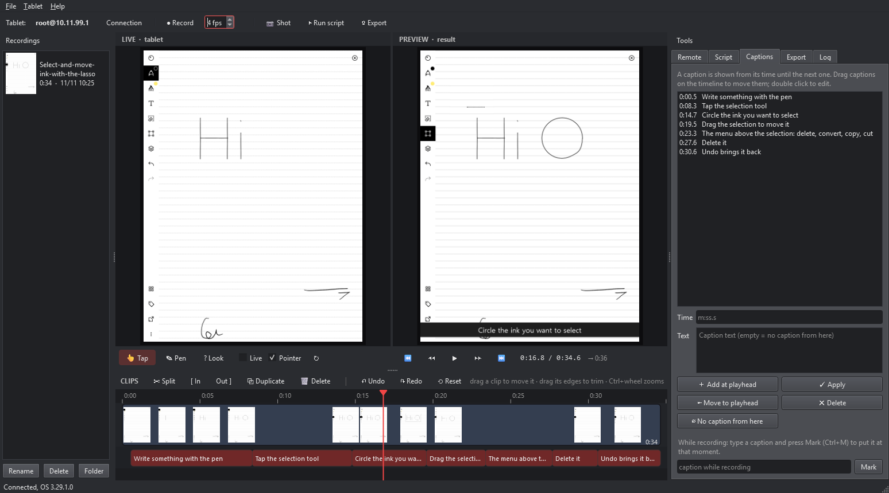

# rmpp-studio

Record, edit and export tutorials for the reMarkable Paper Pro, and drive the tablet from a PC over SSH (by hand, by
script, or by an AI agent). Three parts:

| Part | Runs on | What |
|---|---|---|
| **rmpp-studio** | PC (Windows, macOS, Linux) | A small video editor for tablet tutorials: LIVE monitor you can click on, PREVIEW of the result, clip timeline, captions, export to MP4 / WebM / MOV / GIF / WebP / APNG. |
| **rmpp-ctl** | PC, command line | The same functions as commands and tutorial scripts (`.tut`): tap, draw, type, find UI items, screenshots, recording, rendering. |
| **rmpp-remote** | the tablet | What does the work: an add-on inside xochitl (screen capture from the e-paper framebuffer, recording, UI lookup, text input, active pen) and a small tool (pen / touch input, real pen and finger positions). Installed with rmpp setup, or from rmpp-studio (Tablet > Install). |



*rmpp-studio with a recording open: LIVE view of the tablet (click to tap or draw), PREVIEW of the edited result with
its caption, the clip timeline below, and the caption list on the right.*

Editing and exporting recordings works without a tablet; everything that looks at or touches the tablet needs
rmpp-remote on it.

Tested on OS 3.29 (Qt 6.10).

> The tablet part, rmpp-remote, is one of the **rmpp add-ons**, built on
> [rmpp-packages](https://github.com/lorancecall/rmpp-packages): it is installed by rmpp setup and loaded into
> xochitl by rmpp-preload (no xovi), with all its files under `/usr/lib/rmpp`. How that differs from xovi:
> [how it works](https://github.com/lorancecall/rmpp-packages/blob/main/docs/how-it-works.md).

## Install

1. **The app** on your computer, from the [latest release](https://github.com/lorancecall/rmpp-studio/releases/latest):
   Windows `rmpp-studio-setup-<version>.exe`; Linux `.deb`, `.rpm`, `.AppImage` or `.tar.gz`; macOS
   `rmpp-studio-<version>-macos-<arch>.dmg` (not notarized: right click > Open the first time).
2. **rmpp-remote on the tablet**: install **rmpp setup** from
   [rmpp-packages](https://github.com/lorancecall/rmpp-packages#install) and tick **rmpp-remote** (developer mode is
   needed; that page explains it). Or, once the app is connected: Tablet > Install / update rmpp-remote.
3. Start rmpp-studio: the connection dialog finds the tablet (**USB cable** = 10.11.99.1) and can set up key login.

Details for each system, the command-line tool `rmpp-ctl`, installing from source, building and removal:
[docs/install.md](docs/install.md).

## How it works

| Part | Where | What |
|---|---|---|
| `tablet/rmpp-remote.c` | `/usr/lib/rmpp/rmpp-remote/rmpp-remote` | Writes `input_event`s straight into the digitizer nodes (`/dev/input/event2` "Elan marker input" = pen, `/dev/input/event3` "Elan touch input" = touch, multitouch protocol B). Writing to an evdev node injects the events into that device, so xochitl reads them like hardware input (no uinput device, nothing hot-plugged). Also the client for the add-on socket. |
| `addon/remote.cpp` | `/usr/lib/rmpp/rmpp-remote/librmpp-remote.so`, linked as `/usr/lib/rmpp/preload.d/40-rmpp-remote.so` | LD_PRELOAD add-on in xochitl. Listens on the abstract unix socket `@rmpp-remote`. `QQuickWindow::grabWindow()` for screenshots/frames (own 8-bit grayscale PNG encoder: xochitl's Qt ships no PNG writer plugin), item tree / search / hit test, `QInputMethodEvent` / `QKeyEvent` to the focused item, a log of the pointer events Qt received. |
| `rmpp_ctl.py`, `rmpp-ctl.py` | PC (Python 3 + Pillow; ffmpeg for MP4) | Library + CLI and tutorial runner. One `ssh` call per command (~0.3 s). |
| `rmpp-studio.pyw`, `studio/` | PC (PySide6) | GUI on top of `rmpp_ctl`. |

Why these choices (measured on OS 3.29):
- **Screen**: there is no `/dev/fb*`; `/dev/dri/card0` drives the e-paper panel with a 405x1084 "mode" (packed
  waveform data, not pixels), so reading DRM/framebuffer memory does not give an image. Grabbing the QQuickWindow
  gives the real 1620x2160 picture (about 200 ms per grab), exactly what xochitl renders (toolbar flipped when the UI
  is flipped, selection menus, dialogs). Frames are only written when the screen changed, so long recordings stay small.
- **Input**: writing to the existing evdev nodes is simpler than uinput (xochitl keeps the nodes open and would have
  to discover a new device) and goes through xochitl's normal pen path (ink, lasso, palm rejection). Text goes
  through the add-on because the tablet has no keyboard device unless a Type Folio is attached.
- **Coordinates**: the default screen-to-device maps (pen 11180x15340, touch 2064x2832 over 1620x2160) were checked
  with `pointers` (injected (200,1900) arrived at (200,1899)). If a future OS changes this, write
  `/home/root/.config/rmpp-remote/cal` with two lines `pen ax bx cx ay by cy` and `touch ...`
  (device = a·x + b·y + c).

## CLI

`rmpp-ctl` is on PATH after installing ([docs/install.md](docs/install.md)); from a checkout without installing, use
`python rmpp-ctl.py` instead.

```sh
export RMPP_HOST=rmpp      # ssh host alias (default "rmpp")
rmpp-ctl info                          # window size, focused item, recording state
rmpp-ctl shot screen.png
rmpp-ctl tree | find "Notebook" | hit 56 840 | props '#undoButton'
rmpp-ctl tap 800 1200 | tap '#undoButton' | tap '"Create"' | longpress X Y [ms] | swipe X1 Y1 X2 Y2 [ms]
rmpp-ctl draw circle 700 600 180 | draw rect 950 450 1350 750 | draw arrow X1 Y1 X2 Y2
rmpp-ctl draw points 100,100 300,120 500,400 | line X1 Y1 X2 Y2 [pressure]
rmpp-ctl lasso 450 350 1450 850        # with the selection tool active
rmpp-ctl text "hello 안녕" | key enter | key backspace | key ctrl+a
rmpp-ctl expect '#selectionButton' 5000
rmpp-ctl record start 4 ; ... ; rmpp-ctl record mark "A caption" ; ... ; rmpp-ctl record stop out.gif
rmpp-ctl input < script.txt            # raw tablet script (below), one ssh call
rmpp-ctl run tutorials/lasso-move.tut -o out/lasso-move.gif,out/lasso-move.mp4   # videos need ffmpeg (PATH, $FFMPEG or winget)
rmpp-ctl render recordings/<name> out/demo.webm --codec av1 --quality small   # .mp4 .webm .mov .gif .webp .apng
```

UI queries (`find`, `tap`, `expect`, `prop`): `#objectName`, `"exact text"`, or words that must all appear in the
item's description as printed by `tree` (class, `#objectName`, `"text"`, `icon=name`), e.g. `Button icon=trashcan`.
`tap <query>` uses the top-most visible match and refuses if another item is painted over its center.

Coordinates are xochitl window pixels: portrait 1620 x 2160, origin top left, the same as in screenshots.

### Tablet script (`rmpp-remote` on the tablet)

```
tap X Y [ms] | longpress X Y [ms] | swipe X1 Y1 X2 Y2 [ms]
touch down|move X Y [slot] | touch up [slot]                  multitouch, slots 0-9
pen down|move X Y [P] | pen hover X Y | pen up | pen out       P = pressure 0..1
stroke [P] [speed] : X,Y[,P] X,Y[,P] ...                      polyline, interpolated at speed px/s
line X1 Y1 X2 Y2 [P] [speed]
eraser on|off
sleep MS
raw pen|touch TYPE CODE VALUE
ui <add-on command>
```

### Add-on commands (`rmpp-remote ui <command>` on the tablet)

`ping`, `info`, `source [fb|window|screen]`, `epfb`, `load <exp.so> [arg]`, `shot [path.png] [gray]`, `rec start [dir] [fps] [gray]`, `rec mark <text>`, `rec stop`, `tree [depth]`,
`find <query>`, `center <query>`, `hit X Y`, `prop <name> <query>`, `props <query>`, `text <utf8>`,
`key [ctrl+|shift+|alt+]<name>`, `pointers`.

A recording is a folder with `f000000.png ...` (only changed frames) and `frames.txt` (`<ms> <file>` per sample,
`<ms> # <caption>` per mark); `rmpp-ctl render <folder> out.gif` re-encodes kept frames (`--keep-frames DIR`).

## rmpp-studio (GUI)

A small video editor for tablet tutorials (PySide6 / Qt 6; Windows, macOS and Linux, each release file bundles
everything).

| Area | What |
|---|---|
| **LIVE** (left monitor) | The tablet screen (in color, refreshed every second with **Live**, copied from xochitl's framebuffer so it cannot stall the display). Click = tap, hold = long press, drag = swipe; **Pen** mode: drag = pen stroke; **Look** mode or right click = list the UI items there. **⌨ Keyboard**: what you type goes to the text field focused on the tablet (tap one first): letters and Korean or other input methods (sent when a character is complete), Enter, Backspace, Delete, Tab, Escape, arrows, Home / End, Ctrl+A / C / V / X / Z / Y; one SSH connection for all keys. **Pointer** draws where the real pen (hover ring, pressure dot, stroke trail) and fingers are. |
| **PREVIEW** (right monitor) | The selected recording as it will be exported (clips, shortened pauses, captions). ⏮ ◀◀ ▶/⏸ ▶▶ ⏭ (Space, ←/→ = previous/next change, Home/End). |
| **Clips + timeline** | The recording is cut into clips that play in order: **✂ Split** at the playhead (S), **[ In / Out ]** to trim the clip under the playhead (I / O), **⧉ Duplicate** (Ctrl+D, or Ctrl+C / Ctrl+V), **🗑 Delete** (Delete; the recording keeps the frames), **↶ Undo / ↷ Redo** (Ctrl+Z / Ctrl+Shift+Z), **⟲ Reset**. Drag a clip to move it, drag its edges to trim. Thumbnails show where the screen changed; captions belong to the recording time, so they move with their clip (drag to move, double click to edit). Ctrl+wheel zooms, wheel scrolls. |
| **Recordings** (left) | Your recordings with thumbnails; rename, delete, open the folder. |
| **Tools** (right), in workflow order | **Remote** (type text, keys, quick buttons, find UI items, record actions as script steps), **Script** (`.tut` editor, run + record, try, stop, current line highlighted), **Captions** (list, time, text, add / apply / move / delete, live marks while recording with Ctrl+M), **Export** (format: MP4 / WebM / MOV / GIF / WebP / APNG; codec for videos: H.264, H.265, AV1, VP9, ProRes; quality high / medium / small; fps, size, shorten pauses, hold end; progress; exported files with sizes), **Log**. |
| **Toolbar** | Connection, ● Record (fps; Ctrl+R; stop asks for a name and opens the recording), 📷 Shot, ▶ Run script, ⇪ Export. |

Install: see [Install](#install) above and [docs/install.md](docs/install.md).

Edits of a recording (clips as `segments`, captions, export settings) are saved in its `edit.json` (`rmpp-ctl render <recording> out.mp4` uses it too). Settings
(connection, last script, window layout) are kept in `%APPDATA%\rmpp-studio\studio.json` (macOS:
`~/Library/Application Support/rmpp-studio/`, Linux: `~/.config/rmpp-studio/`); recordings in `recordings/`.

## Tutorials

See [tutorials/README.md](tutorials/README.md) and the example [tutorials/lasso-move.tut](tutorials/lasso-move.tut)
(recordings: [examples/lasso-move.gif](examples/lasso-move.gif), [examples/lasso-move.mp4](examples/lasso-move.mp4)).

## Capture: framebuffer copy (default) vs window grab

**Fixed (2026-11-11):** captures now copy xochitl's e-paper framebuffer instead of rendering the scene again
(`ui source fb`, the default). xochitl's `EPFramebuffer` object (the source Screen Share reads from) is not in the
object tree, so the add-on interposes `QMetaObject::activate` (xochitl calls it through the dynamic linker): when
an `EPFramebuffer` emits a signal, the add-on keeps the sender. Inside it is the panel image (a 1620x2160 RGB32
`QImage`, found by comparing the object's words with QImage's vtable); a shot copies its rows. Recording copies a
frame only when `framebufferUpdated(QRect)` fired since the last one. Test with the developer: 60 s at 4 fps with
page turns, quick-settings taps and fast pen scribbles, no freeze (the window grab froze the panel within 10-30 s
under the same conditions). `ui epfb` shows what the hook found. Until the first screen update after a xochitl start
the framebuffer is unknown and a shot falls back to one window grab. `ui source window` brings back the old method.

### History: the window grab froze the e-paper display


Reproduced on 2026-11-11 in a controlled test (one capture process only, the developer using the tablet):

| Phase | Captures | Developer's input | Result |
|---|---|---|---|
| 1 | `ui shot` once per second, 40 s | page turns, menus, fast pen scribbles, finger taps | display kept updating |
| 2 | `rec start ... 4` (about 3.5 grabs/s), 40 s | same; quick finger taps on the quick-settings corner, fast pen scratching | display froze after 10-15 s and stayed frozen after the captures stopped |

While frozen, xochitl kept working: input was handled and `ui shot` showed the new UI state (Qt still renders),
the e-paper threads (framegen, vsync-flip, swt-*, EPFramebufferQueue) all sat idle on futexes, and only a xochitl
restart brought the panel back. So `QQuickWindow::grabWindow()` (a second render of the scene on the GUI thread)
sometimes leaves xochitl's e-paper update pipeline waiting for an update that never comes, more likely the more often
it runs and when it coincides with fast partial updates (pen, animations). The earlier freeze (four minutes at about
one grab per second from two processes) fits this.

Re-test the same day (experiments run inside xochitl with the add-on's dev loader, `ui "load <so> [arg]"`):
the freeze came back after 28 s at 4 fps. While frozen: xochitl's full refresh (`GhostBuster_Gallery3.userRequestedClear()`)
did reach the panel once (it flashed) but normal updates stayed stuck; `QQuickWindow::update()`, `requestUpdate()`,
an expose event and dirtying every item did not help; only a restart did. So the stall is in xochitl's own e-paper
partial-update path, not in Qt's render loop. `QScreen::grabWindow()` (`ui "source screen"`) returns nothing on this
platform plugin, and xochitl's `EPFramebuffer` object is not reachable from the QObject tree.

Until there is a safe capture path: keep **Live** off (default), prefer single shots, keep recordings short and slow
(1-2 fps), and restart xochitl if the panel freezes. Next: capture without re-rendering (`QScreen::grabWindow()` /
the epaper plugin's framebuffer) and repeat the phase 2 test.

## Safety notes

- Injected input is real input: a wrong coordinate taps whatever is there. Run scripts in a notebook made for
  testing, start tutorials with `setup expect ...` so they stop on the wrong screen, and do not touch the tablet
  while a script runs (real and injected touches mix).
- Recordings and screenshots show whatever is on screen (file names in the library, account e-mail in Settings).
  Check them before sharing.
- The pointer log (`pointers`) is cleared and paused while the passcode screen has focus.

## License

GPL-3.0-only. See [LICENSE](LICENSE).
